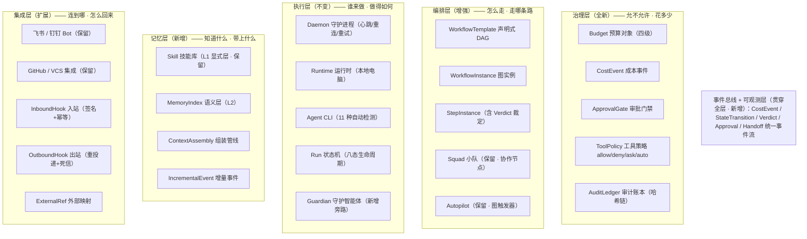
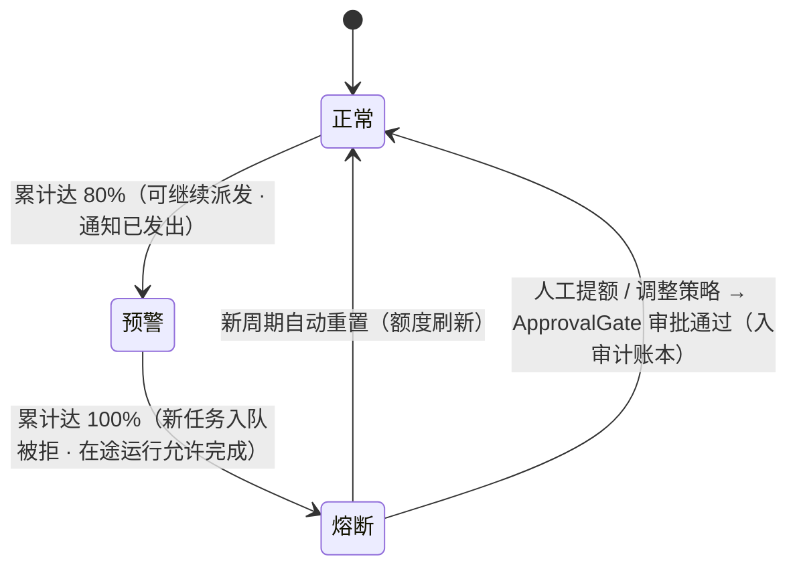
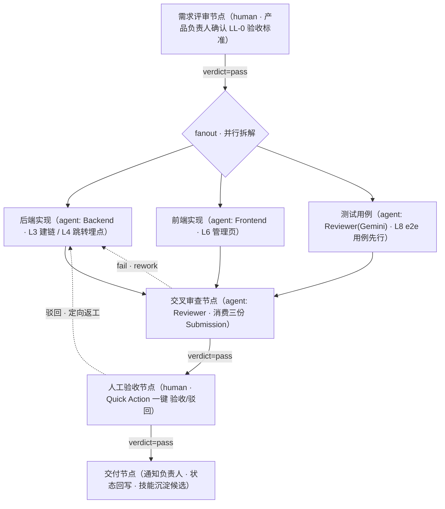
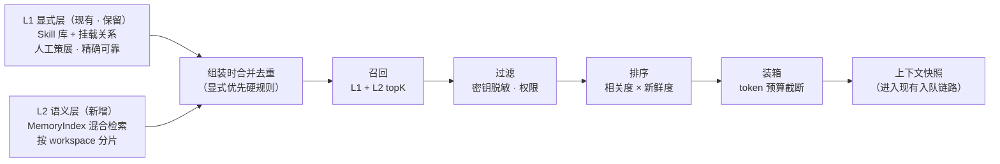
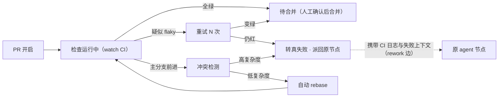

# Multica 改进架构设计书 —— 从 Managed Agents 到 Governed Workflows

> **Multica 落地系列 · 第 3 册（架构篇）** · 内部代号 **Multica-NG**
> 配套：《Multica 自部署使用与运维手册》（第 1 册）、《从 0 到 1 实操 Demo 教程 · LinkLite 例程》（第 2 册）。
> 本 Markdown 版与交互 HTML 版同内容，便于进 git 做版本化评审与 diff。
> 深度：概念级蓝图（Concept-level Blueprint）· 读者：研发实现团队 · 篇幅：约 1 万字。

**改进设计基于**：Multica 官方公开文档与概念模型（现状基线）；Paperclip（预算治理与审计）、OpenAI Symphony（工作流 DAG 与 CI 护航）、Anthropic Claude Managed Agents（企业管控）、一线团队「AI 军团」二次开发实践（三根骨架 + Verdict 准出）等 2026 年 Managed Agents 赛道最佳实践。

---

## 目录

- [00 设计总览与阅读指南](#00-设计总览与阅读指南)
- [01 背景与动机：为什么改](#01-背景与动机为什么改)
- [02 现状基线与保留不动清单](#02-现状基线与保留不动清单)
- [03 总体目标架构：六层蓝图](#03-总体目标架构六层蓝图)
- [04 子域 A · 预算与成本治理（P0）](#04-子域-a--预算与成本治理p0)
- [05 子域 B · 工作流运行时（P0）](#05-子域-b--工作流运行时p0)
- [06 子域 C · 记忆与上下文层（P1）](#06-子域-c--记忆与上下文层p1)
- [07 子域 D · 治理、审计与审批（P1）](#07-子域-d--治理审计与审批p1)
- [08 子域 E · 外部系统交接（P2）](#08-子域-e--外部系统交接p2)
- [09 子域 F · CI 护航（P2）](#09-子域-f--ci-护航p2)
- [10 非功能设计](#10-非功能设计)
- [11 迁移与兼容策略](#11-迁移与兼容策略)
- [12 实施路线图与人力估算](#12-实施路线图与人力估算)
- [附录 A 变更登记清单（43 条）](#附录-a-变更登记清单43-条)
- [附录 B 人机分工 RACI](#附录-b-人机分工-raci)
- [附录 C 术语表与三册对照](#附录-c-术语表与三册对照)

---

## 00 设计总览与阅读指南

Multica-NG 不是重写 Multica，而是在其之上补齐「治理、编排、记忆」三块企业级拼图。

**关键数字**：6 个改进子域（A–F，P0/P1/P2 分级）· 21 个新增核心概念 · 43 条变更登记项 · 3 个实施阶段（约 16–20 周 · 290 人日粗估）· 0 条破坏性变更（全部叠加式演进）。

### 六大改进方向一览

| 子域 | 名称 | 优先级 | 一句话 | 主要借鉴 |
|---|---|---|---|---|
| A | 预算与成本治理 | **P0** | 四级预算对象 + 成本事件流 + 80% 预警 / 100% 熔断 / 人工恢复状态机，超支在发生前被拦住 | Paperclip（按 agent 硬预算）、CMA（会话预算硬顶） |
| B | 工作流运行时 | **P0** | 现有「单线状态机 + 列交接」升级为有向图：并行分支、条件网关、结构化准出裁定（Verdict）、定向返工 | Symphony（DAG + 状态机）、「AI 军团」（Template/Node/Edge + Verdict） |
| C | 记忆与上下文层 | P1 | 保留显式技能库（L1），新增语义检索层（L2）与组装管线；快照按 token 预算装箱、执行中增量保鲜 | 社区对 Multica 记忆模型的批评 + mem0 式上下文层思路 |
| D | 治理审计与审批 | P1 | append-only 哈希链审计账本、审批门禁、工具级权限策略（allow/deny/ask/auto） | CMA（auto 权限评估）、Paperclip（不可变审计） |
| E | 外部系统交接 | P2 | 双向 Hook 打通需求/缺陷/验收系统；幂等、重放、对账三机制 | 「AI 军团」（外部可交接骨架） |
| F | CI 护航 | P2 | 专职守护智能体盯 PR 最后一公里：flaky 重试、自动 rebase、冲突分流、定向派回；合并永远留给人 | Symphony（watch CI / rebase / retry flaky） |

### 阅读路径

- **技术决策者**：第 1 → 3 → 12 章，约 15 分钟。
- **子域负责人**：第 3 章通读后直奔自己负责的子域章节 + 附录 A 对应条目。
- **实施工程师**：全读；以第 11 章迁移策略为操作入口，附录 A 作为 issue 拆解的原始输入（建议直接导入工作区看板，每条变更项即一张卡）。

### 与前两册的关系

第 1 册解决「装起来、养起来」，第 2 册用 LinkLite 例程证明「全流程跑得通」。跑通之后自然长出三个问题：**成本失控怎么办（子域 A）、链路复杂了怎么编排（子域 B–F 执行侧）、出了事怎么追责（子域 D）**。本册是对这三个问题的系统性回答——所有设计以「不破坏第 1、2 册已验证的部署面与操作路径」为前提：改动完成后，LinkLite 例程应能原样重跑，且全程受预算护栏与工作流运行时保护。

> **定位声明**：本册为概念级蓝图，面向研发实现团队撰写，但刻意停留在「概念模型 + 契约 + 状态机」层面，不落到具体表字段、迁移编号与文件路径——后者属详细设计（DDD）阶段，由各子域负责人在原型验证后补全。文中 Multica 现状描述均以官方公开文档与概念模型为准。

---

## 01 背景与动机：为什么改

Multica 已经证明了「agent 作为队友」的日常可用性。但当队列从每天几个任务变成上百个运行、从单智能体变成多小队并行时，四个结构性短板开始收税。

### 1.1 四大结构性短板

**短板一：成本没有闭环。** Multica 有用量看板（usage / analytics），能看历史消耗，但那是「事后会计」——没有任何对象表达「这个项目本月最多花多少钱」。对比赛道做法：Paperclip 给每个 agent 设月度美元预算，到 80% 预警、到 100% 自动暂停、新任务直接挡在门外；Claude Managed Agents 给每个会话设硬顶，触顶即停而非记账。Multica 缺的正是这条「事前闸门」，多智能体并行时尤其危险——失控循环一夜烧掉大量 token 的事故在社区里并不罕见。

**短板二：工作流只有单线。** 现有 Workflows 的模型是「状态列 + 交接」：issue 进入某列触发一次交接，节点完成后「移至下一列」、被拒绝时「退回指定列」。这覆盖了线性交付，但表达不了三件越来越常见的事：**并行**（一个需求同时拆给后端 / 前端 / 测试用例三个智能体）、**条件路由**（按风险等级走不同评审深度）、**结构化准出**（下游只能读自然语言评论判断上游成败）。Symphony 的经验说明后者危害最大：当 agent 输出不稳定时，下游节点消费的应当是结构化裁定（pass / fail / blocked / rework），而不是再次推理一段散文。

**短板三：记忆只显式、快照会过期。** 技能靠 `agent_skill` 显式挂载——精确、可控，这是 Multica 的优点，社区分析也证实「人工筛选的相关性往往优于统计相似」；但另一面是：未挂载的技能永远沉睡，任务执行中的新评论进不了已打包的上下文快照，且随着技能库增长（如 200 个技能），快照体积持续膨胀。一线团队把这类问题总结为「缺乏模糊检索、快照过时、快照随库膨胀」三连。

**短板四：治理是旁路而非内建。** Multica 有活动流（activity_log）与成员角色，但审计不是第一公民：没有防篡改的账本、没有可挂在敏感动作前的审批门禁、没有工具级权限策略。对比 CMA 的 auto 权限模式（服务器逐次评估每个工具调用：放行 / 拒绝 / 暂停等人批准）与 Paperclip 的 append-only 审计（每次工具调用、每个决策点都入不可变日志），「谁批准了这次超预算」「这个返工是谁驳回的」在现版本里只能靠翻评论拼。

### 1.2 竞品借鉴矩阵：各取所长，而非全盘照搬

| 来源 | 值得借鉴的核心机制 | 落入子域 | 为何不整体采用 |
|---|---|---|---|
| **Paperclip**（MIT 开源 · 组织树治理） | 按 agent / 项目的硬预算与熔断；append-only 审计；心跳调度；审批门禁 | A、D | 组织树（CEO/CTO 角色层级）对研发协作偏重；无飞书生态与 11 种 CLI 自动检测的看板体验；早期粗糙（公开 issue 数千计） |
| **OpenAI Symphony**（开源规范 SPEC.md） | Linear 状态机作控制面；任务 DAG 依赖；PR 生命周期护航（rebase / 解冲突 / 重试 flaky）；WORKFLOW.md 随仓库版本化 | B、F | v1 仅绑定 Codex + Linear；无 Web UI 与多租户；其「无数据库」哲学与 Multica 的持久化任务模型相左 |
| **Claude Managed Agents**（Anthropic 云服务） | 会话预算硬顶与 budget_reached 暂停；auto 权限逐次评估；网络白名单与防外泄；OpenTelemetry 全链路追踪 | A、D | 闭源云服务，仅支持 Claude 生态；自托管自由度与厂商中立性正是 Multica 的立身之本 |
| **「AI 军团」二次开发**（一线团队实践 2026-07） | 统一 agent 池四种派单策略；Workflow Template/Node/Edge 运行时；Submission + Verdict 结构化准出；定向返工带 rework 上下文；Sweeper 自愈；四层指标 | B、E、横切 | 其外部交接与门户集成深度定制于自身需求；直接照抄会放大维护面，取其骨架概念即可 |

四个参考系的共同点：都不认为「换掉 agent」是答案，竞争发生在编排与治理层。

### 1.3 设计目标（可衡量）

| 编号 | 目标 | 验收口径（概念级） |
|---|---|---|
| G1 | 每一次运行都处于某级预算管辖之下 | 预算熔断覆盖率 100%；熔断后新任务入队被拒并通知，不产生静默扣费 |
| G2 | 工作流可表达并行与条件路由 | 单模板支持 ≥ 5 并行分支与 AND 收敛；下游节点只消费 Verdict 字段 |
| G3 | 上下文召回可发现未挂载知识 | 语义层召回 P95 延迟 ≤ 300ms；快照 token 占用受预算装箱约束 |
| G4 | 关键动作可审计、不可篡改 | 审计账本哈希链可校验；「谁批准 / 谁驳回 / 花费几何」单查询可得 |
| G5 | 外部交接不丢不重 | 入站事件幂等去重；出站失败重投递 + 死信；周期对账可发现漂移 |
| G6 | PR 最后一公里自动化 | flaky 自动重试；可解冲突自动 rebase；「自动恢复率」成为可统计指标 |

六条目标与六大子域一一对应（G1↔A、G2↔B、G3↔C、G4↔D、G5↔E、G6↔F）。

### 1.4 非目标：明确不做什么

- 不做模型训练与自研 CLI——继续复用现有 11 种 agent CLI 生态与 daemon 本地执行模型，算力与密钥留在用户机器上。
- 不替换现有 UI 范式——看板、issue 时间线、收件箱交互保持；新概念以「详情面板 / 设置页扩展」形式出现。
- 不动 Workspace 隔离模型——所有新表继续以 workspace 为界、级联删除，不引入跨工作区共享存储。
- 不追求替代飞书 / 钉钉 / GitHub 专用集成——外部交接是通用底座，专用集成保留并逐步上移。
- 不实现「无人值守自动合并」——所有 Verdict=pass 的产物仍需人工验收，这是 Multica「nothing ships without a human」的底线。

---

## 02 现状基线与保留不动清单

改进的前提是精确理解现状。好的架构改进，一半靠加，一半靠忍住不加。

### 2.1 概念模型速览

Multica 的世界由四组对象构成：**容器组**——工作区（Workspace，一切的范围）与项目（Project，相关任务的聚合，可绑定仓库等资源）；**执行组**——智能体（Agent，可复用配置：指令 / 模型 / skill / Access / 运行时）、Skill（可复用能力包，跨智能体共享）、运行时（Runtime，执行发生的电脑）与运行（Run，一次具体执行记录）；**协作组**——任务（Issue，日常工作单位，负责人可以是成员、智能体或小队）、小队（Squad，leader 智能体带领的多智能体协同）、对话与收件箱；**自动化组**——自动化（Autopilot，按时间表或外部事件触发执行）。触发方式有四条：分配、@提及、对话、自动化（现有 Workflows 的列交接本质上也是一种分配触发）。

### 2.2 执行链路与运行生命周期

一次典型执行的完整链路：触发 → 构建上下文快照（工作区上下文 + 任务 + 关联任务 + 挂载技能）→ 入队 → daemon 通过待处理队列轮询获取 → 调用对应 agent CLI 加载技能执行 → 过程中持续写回评论与状态（WebSocket 实时推送）→ 结果沉淀为可复用技能。

运行（Run）状态机（简化）：`queued → dispatched → waiting_local_directory → running → completed / failed / cancelled`。每步状态转换都被跟踪并广播，无「无声失败」。

可靠性地毯包括：daemon 心跳（默认 15 秒级）、断线重连宽限（小时级）、每机并发上限（agent 级与整机级双层）、临时错误的自动重试与网络错误的更高次数重试、以及自动化熔断（7 天内失败次数与失败率双阈值触发暂停）。这些机制在 P0 两个子域中全部复用，不改一行语义。

### 2.3 协作机制：小队与任务阶段

小队协议是 Multica 最精巧的现有设计：leader 智能体收到任务后向成员发出简报（Squad Operating Protocol + 名单 + 指令），以 `@成员` 方式派活；成员完成后**不带 @ 地回复**（静默汇报，避免互相唤醒）；只有显式 `@leader` 才把队长拉回。任务阶段机制则实现了「级联唤醒」：一个任务的各阶段依次完成，最早未完成阶段全部 done 时，系统自动唤醒父任务负责人。这两个机制天然就是「有向图运行时」的雏形——子域 B 不是替换它们，而是把这套隐式协议升级为显式声明式模板。

### 2.4 现有 Workflows 的能力边界

| 现有能力 | 机制 | 边界（NG 要补的） |
|---|---|---|
| 状态列即流程 | 项目选模板（Delivery / Content / Community），看板列即状态 | 单 issue 单链，一列只能有一个交接目标 |
| 列交接触发 | 进入某列 → 无交接 / 交给智能体 / 交给成员，可在时间线查看简报 | 无法按条件分流（网关缺失） |
| 两跳路由 | 「完成后移至」+「被拒绝退回」 | 仅线性前进与一步回退；无并行收敛、无跨节点定向返工 |
| 上下文继承 | 描述、讨论、先前结果留在同一 issue 上 | 准出结论是自然语言评论，下游需再次阅读理解 |

子域 B 的定位：把「列」升级为「节点」，把「交接」升级为「边」。

### 2.5 保留不动清单（安全区）

以下机制在 Multica-NG 中保持原样，任何子域不得破坏其语义：

- **Workspace 隔离与级联删除**——所有新增概念继续以工作区为界，删工作区即净身出户。
- **Daemon + Runtime 本地执行模型**——算力、密钥、代码目录留在用户电脑；NG 的新检查点全部是「派发前置」而非「远程执行」。
- **11 种 agent CLI 自动检测**——厂商中立是立身之本，新子域不得引入对特定 CLI 的硬依赖。
- **Squad 协作协议**——leader / 静默汇报 / 让位规则原样保留，并可作为子域 B 中的「协作节点」整体入图。
- **Issue 时间线与评论模型**——所有新事件的呈现都写回时间线，不另立消息中心。
- **Autopilot 触发器**——保留为工作流的合法触发源之一（定时 / 外部事件 → 启动图实例）。
- **飞书 / 钉钉 / GitHub 集成与长连接事件**——通知面不动；子域 E 只增加通用 Hook 底座。
- **自托管部署面**——延续第 1 册验证的 `make selfhost` 与就绪检查路径，新子域全部默认关闭、按需开启。

> **为什么「不动」是设计决策而非偷懒**：一线二次开发案例的教训清单里，「快照可能过时」「缺乏跨工作区记忆」等短板全部源自早期侵入式改动。叠加式演进让每一步都可以独立回滚（第 11 章），也让 upstream 升级冲突面最小（第 12 章风险 R5）。

---

## 03 总体目标架构：六层蓝图

目标架构只有一句话：**在 Multica 现有执行底座之上，叠加「治理 + 编排 + 记忆」三块企业拼图，用一条贯穿全层的事件总线缝合**。



执行层整层保持不动是刻意决策：算力与密钥留在用户机器，NG 的所有控制点都是「派发前检查」而非「执行中介」。

### 3.1 演进三原则

1. **插件化**：六大子域各自是可插拔模块——预算可以只开 A 不开 B，治理可以只开账本不开审批。全部关闭时系统行为与现状逐字节一致。「关掉等于没改过」是回归测试的黄金标准。
2. **开关化**：每个子域一个特性开关，支持按工作区灰度：先开一个试点工作区跑影子模式，对比无异常后再全量。开关状态本身入审计账本。
3. **不破坏**：新概念一律以「引用」方式挂接旧对象，而非替代：StepInstance 引用 Issue 而非取而代之，Budget 挂在 Agent/Project 之上而非改造它们。旧数据永不迁移删除。
4. **贯穿原则 · 事件化**：一切状态变化都是事件——成本是事件、裁定是事件、审批是事件、交接是事件。审计与指标是同一事件流的两种消费，不搞两套采集。

### 3.2 旧概念到新概念映射

| 现有概念 | 处置 | NG 中的新位置 | 说明 |
|---|---|---|---|
| Workflows（列状态机） | 升级 | WorkflowTemplate（有向图） | 现有模板可一键导入为线性图；列交接语义保留为「节点边」 |
| usage / analytics 看板 | 升级 | CostEvent 事件流 + 预算看板 | 历史计量口径不变，新增「未来额度」视角 |
| activity_log 活动流 | 扩展 | AuditLedger 审计账本 | 活动流保留为展示层；账本为防篡改存储层 |
| Skill / 挂载关系 | 保留 | 记忆层显式层（L1） | 新增语义层（L2）做补充召回，不改挂载语义 |
| Squad 小队 | 保留 | 图中的「协作节点」类型 | 小队整体作为一个节点入图，内部协议不变 |
| Autopilot 自动化 | 保留 | 图触发器（定时 / 事件） | 自动化触发可指向「启动某个图实例」 |
| 收件箱 Inbox | 保留 | 审批 / 预警通知入口 | ApprovalGate 的待办直接进收件箱 |
| Quick Actions | 保留 | 验收 / 驳回快捷按钮 | 人工验收节点的操作面板 |

概念映射：三升、一扩、四保留。全书没有一条「删除」。

### 3.3 新增概念总账

六大子域共引入 **21 个新概念**（治理层 6、编排层 5、记忆层 3、集成层 3、执行层旁路 1、横切 3），登记为 **43 条变更项**（编号 NG-A01 至 NG-X05），每条含类型（新增概念 / 扩展概念 / 新增接口 / 新增配置 / 迁移注意）、优先级与粗估工作量——详见附录 A。

> **一张图记住全书**：治理层管「钱与权」（第 4、7 章），编排层管「路与裁定」（第 5 章），记忆层管「上下文」（第 6 章），集成层管「进出」（第 8 章），CI 护航是执行层旁路（第 9 章），事件总线把它们全部缝合（第 10 章）。

---
## 04 子域 A · 预算与成本治理（P0）

目标 G1：每一次运行都处于某级预算管辖之下，超支在发生前被拦住。核心思路是把「花钱」从看板上的统计数字，变成派发链路上的三道闸门。

### 4.1 概念模型：四级预算 + 事件流

| 概念 | 职责 | 关键属性（概念级） |
|---|---|---|
| `Budget` | 某一级对象的额度声明 | 归属层级（工作区 / 项目 / 智能体 / 单次运行）、周期（月 / 周 / 固定总额）、额度、预警线（默认 80%）、熔断线（默认 100%）、超限动作 |
| `BudgetPolicy` | 额度规则的策略包 | 周期重置方式、是否允许超限排队、预警通知目标（收件箱 / 飞书）、恢复方式（自动新周期 / 人工提额） |
| `CostEvent` | 不可变成本事件（append-only） | 归属（workspace/project/agent/run 四维）、计量（token 输入输出 / 折算费用）、来源（CLI 上报 / 估算）、发生时间 |
| `QuotaSnapshot` | 额度余量的可读快照 | 当前周期已用 / 剩余、所处状态（正常 / 预警 / 熔断）、最近一次重置时间 |

四级取**最严者生效**：工作区宽松而项目紧张时，按项目的紧额度拦截。

### 4.2 预算状态机



注意「熔断不杀在途」：已开始的运行允许自然完成并计费，避免半途而废的沉没成本——这与 CMA 的 budget_reached「暂停而非终止」语义一致。熔断解除后，已排队任务按序恢复派发。

### 4.3 三道闸门：入队 / 派发 / 核销

| 闸门 | 时机 | 行为 |
|---|---|---|
| **入队闸** | 任务进入待处理队列时 | 按任务预估成本（无预估则按同类任务 P50 成本）与当前余量比对：不足则拒绝入队并通知负责人，附「预估 vs 剩余」明细 |
| **派发闸** | daemon 领取任务、启动 CLI 前 | 原子性预扣一笔预留额度（防止并发任务同时透支）；预扣在运行结束核销 |
| **核销闸** | 运行完成、CostEvent 落账时 | 实际计量冲抵预扣，多退少补；触发状态机重算（可能跨入预警 / 熔断态） |

三道闸门全部是「派发前 / 派发时 / 完成后」的记账动作，daemon 与 CLI 的执行语义零改动。

### 4.4 与现有 analytics 的关系

现有用量看板回答「过去花了多少」，Budget 回答「还允许花多少」；两者共享同一 CostEvent 事件流——看板是事件流的**回放视角**，预算是事件流的**前馈控制**。实现上不再另做采集：CLI 上报的用量数据落成 CostEvent 后，一边进看板聚合、一边累加进 QuotaSnapshot。历史 usage 数据建议回填为 CostEvent（第 11 章），使预算基线可以从真实历史学习出「同类任务 P50 成本」。

### 4.5 场景走查：LinkLite 例程中的预算护栏

沿用第 2 册例程：某月项目「LinkLite」预算 200 美元，智能体 Backend 月度子预算 80 美元，L7（鉴权与限流）任务预估 6 美元。

1. 月初任务逐个完成，CostEvent 累计 Backend 已用 77.2 美元 → 触发 80% 预警，收件箱与飞书群收到预警通知，任务照常。
2. L8（e2e 测试）入队时预估 4 美元：77.2 + 4 < 80，放行并预扣 4 美元；运行完成后实际 3.1 美元，冲抵退回 0.9 美元。
3. L9（部署文档）预估 3 美元：放行。但该任务实际跑超并进入修复循环，核销时累计达 82.7 美元 → **熔断**。
4. 此后队长试图派发新子任务，入队闸拒绝并附明细（预估 5 美元 vs 剩余 -2.7 美元）；helper 管家智能体收到事件，在 issue 时间线留下熔断说明。
5. 负责人判断循环属正常返工，将 Backend 子预算提至 100 美元 → ApprovalGate 向工作区 admin 发审批（收件箱直达，一键批准）→ 审批入审计账本 → 熔断解除，排队任务恢复派发。

**验收口径（对应 G1）**：全程没有任何一笔「无预算管辖」的运行；熔断到恢复的每个动作（拒绝、通知、提额、批准）在审计账本中单查询可得。

### 4.6 设计边界与已知取舍

- **计量误差**：本地执行的 token 用量依赖 CLI 上报，允许 5% 容差缓冲（预警线默认 80% 而非 95% 即为此留白）；预留-核销机制吸收并发透支。
- **故障降级**：预算服务不可用时 **fail-closed**（暂停派发而非放行）——宁可停也不失控。
- **不做的事**：不做跨工作区合并预算、不做实时汇率折算（费用按固定单价表折算）、不做按模型降价建议——那是运营工具，不是架构。

---

## 05 子域 B · 工作流运行时（P0）

目标 G2：把「单线状态机 + 列交接」升级为**声明式有向图运行时**。三个关键词：并行（fan-out / 收敛）、结构化准出（Submission + Verdict）、定向返工（rework-context）。现有 Workflows 不废弃，一键导入为线性模板。

### 5.1 对象模型：模板 → 实例 → 步骤

| 概念 | 职责 | 关键属性（概念级） |
|---|---|---|
| `WorkflowTemplate` | 声明式有向图（版本化） | 节点集 + 边集（含条件表达式）、全局上下文、导入来源（新建 / 从现有 Workflow 导入） |
| `WorkflowNode` | 图节点（六种类型） | 类型（agent / human / squad协作 / gateway网关 / fanout+join并行 / timer定时 / subworkflow子图）、准出条件、超时与 blocked 策略 |
| `WorkflowEdge` | 有向边 | 源 / 目标节点、条件表达式（消费上游 Verdict 与业务字段）、默认边标记 |
| `WorkflowInstance` | 一次图的运行 | 模板版本引用、触发源（人工 / Autopilot / InboundHook）、外部引用、整体状态 |
| `StepInstance` | 节点的一次执行 | 关联 Issue 与 Run、Submission（提交物）、Verdict（裁定）、重试次数、rework 上下文 |

StepInstance 始终**引用** Issue——看板、评论、@提及等现有交互原样可用。

### 5.2 结构化准出契约：Submission + Verdict

这是整个子域 B 乃至全书的枢纽设计。agent 节点完成时不再只留一段自然语言评论，而是提交一份结构化 Submission，系统据此派生统一的 Verdict：

```json
// Submission —— 智能体节点完成时提交（概念级契约）
{
  "deliverables": [ { "kind": "pr", "ref": "链接" },
                    { "kind": "analysis", "ref": "评论锚点" } ],
  "verdict":      "pass" | "fail" | "blocked" | "rework",   // 流程裁定
  "reason":       "根因解释（一段人可读的话）",
  "confidence":   0.0 - 1.0,
  "metrics":      { "tests_added": 12, "files_touched": 5 }
}
// Verdict 由系统按节点准出条件校验后落账；下游节点与边条件只消费 Verdict 与
// deliverables 引用，不再解析自然语言。人工节点的验收动作同样落成 Verdict。
```

业务产物 / 流程裁定 / 根因 / 置信度四件套，无论这一步交给哪个 agent，下游消费方式不变。

### 5.3 示例：LinkLite 发布工作流（DAG 全景）

对应第 2 册 LL-0 的三阶段拆解：并行开发 → 交叉审查 → 人工验收；虚线为定向返工路径。



**rework 定向返工**：人工验收驳回 → 只回到「后端实现」等指定节点（非全链重跑）；新一轮 StepInstance 自动携带 rework-context（驳回原因 + 受影响范围 + 上轮 metrics），通过 `@节点` 派回原 agent。审查节点 fail → 回对应实现节点；整体 blocked → 暂停并通知。

对比现状：同样的工作在现有 Workflows 里需要三个 issue 串行走完，且无法并行、无结构化裁定。

### 5.4 并行与失败策略

| 场景 | 策略 | 语义 |
|---|---|---|
| fan-out 分支 | 并行 StepInstance | 每个分支独立生成 Issue 与 Run，预算各自过闸；天然复用现有并发上限（agent 级 / 整机级） |
| AND 收敛 | 全部完成才推进 | 任一分支未完成则汇聚节点等待；等待中 blocked 上报沿用现有机制 |
| 兄弟分支 fail | 按模板三选一 | fail-fast（终止兄弟）/ continue（容忍，收敛时按裁定合并）/ rework（仅失败分支重跑） |
| 节点超时 | 模板可配 | 标记 blocked + 通知（默认），或自动重试（复用现有临时错误重试语义） |

Sweeper 式自愈（长时间 running 重置、孤立任务重分发）沿用现有 daemon 行为，不重复建设。

### 5.5 与现有机制的接缝

- **Issue 不变**：每个 agent / human / squad 节点激活时创建或复用 Issue——看板、评论、@提及、收件箱全部原样工作。
- **Squad 作为协作节点**：小队整体入图时，内部 leader 协议、静默汇报、让位规则不变；小队对外的完成汇报落成一份 Submission。
- **Autopilot 作为触发器**：定时 / 外部事件触发「启动图实例」，替代原本只能触发单次执行的限制。
- **现有 Workflow 导入**：线性列模板一键转为「节点-边」线性图（列 = 节点，交接 = 边，「完成后移至 / 退回」= 默认边 / 返工边），导入后可增量添加并行与网关。
- **阶段机制兼容**：现有任务阶段唤醒继续工作；图中节点完成即阶段 done，父级唤醒逻辑复用。

### 5.6 设计边界

- **不做通用工作流引擎**：不做循环边、不做动态图（运行中改拓扑）；需要循环的场景用 subworkflow + 显式重试表达。Symphony 的教训：把 agent 当刚性状态机节点会浪费其推理能力，因此节点给的是「目标 + 准出条件」，不是脚本步骤。
- **不做跨工作区模板共享**：模板以工作区为单位；受控导出 / 导入留作运营功能。
- **Verdict 不裁决业务对错**：裁定只回答「这一步是否达到其声明的准出条件」；业务对错永远由人工验收节点（或集成层的外部验收）说了算。

---

## 06 子域 C · 记忆与上下文层（P1）

目标 G3：让智能体「带得上该带的、找得到没挂的、用得起新鲜的」。设计立场：显式技能库（人工策展）是 Multica 的优点，保留为 L1；新增 L2 语义检索层做补充，而非替代——检索错误的代价，在代码类任务里高于筛选成本。

### 6.1 双层记忆与组装管线



管线终点仍是现有的「快照入队」机制——记忆层换的是快照的**内容来源**，不是投递方式。L2 召回永远不覆盖显式挂载，只补 L1 覆盖不到的空白。

### 6.2 快照保鲜：增量事件通道

针对「快照一次性、执行中新评论进不来」的批评，设计一条轻量增量通道：运行期间，任务上的**新评论、blocked 标记、验收驳回**以 IncrementalEvent 追加到该 Run 的待注入队列；daemon 心跳节拍上顺带投递（复用现有心跳，不新增连接）。智能体侧表现为会话中出现一条带时间戳的系统注入消息——不重建快照、不打断执行。对长任务（小时级）这是「保鲜」与「稳态」的折中：重大上下文变化（如任务被改派）仍走取消重启，不强行热更。

### 6.3 技能生命周期治理

| 阶段 | 机制 | 要点 |
|---|---|---|
| 候选生成 | 运行完成后的沉淀候选 | Verdict=pass 且含可复用模式的 Submission 自动进入候选队列 |
| 评审晋升 | 人工确认后才成为 L1 技能 | 评审动作走收件箱；拒绝的候选仍留在 L2 可被语义召回——「不晋升但可发现」 |
| 衰减淘汰 | 引用计数 + 成功率衰减 | 长期零引用或成功率滑坡的技能标记待退役，人工确认后归档（不物理删除） |
| 去重合并 | 相似度提示 | L2 检测到高度相似技能时向维护人发合并建议，防技能库腐化 |

对应社区指出的「技能质量依赖团队习惯，不及时沉淀就退化」——把习惯变成流程。

### 6.4 快照体积控制

技能库增长带来的快照膨胀（200 个技能即很大的上下文块）由管线「装箱」环节统一解决：L1 挂载项与 L2 召回项在同一个 token 预算内竞逐，超预算时按（相关度 × 新鲜度 × 是否显式挂载）排序截断，被截断项以「可按需引用的索引行」形式保留占位（智能体可通过工具调用按需拉取全文）。快照体积从「随库增长」变为「恒定预算 + 按需展开」。

### 6.5 设计边界

- **不做跨工作区记忆**：L2 索引严格按 workspace 分片；「技能市场」式受控导出 / 导入属运营功能，不在架构范围。
- **检索不覆盖挂载**：L2 召回永不挤占 L1 显式挂载项的预算份额——显式优先是硬规则。
- **隐私红线**：过滤环节对密钥、凭据模式做硬脱敏；L2 索引内容与权限模型联动（无权限对象不进召回候选）。
- **可降级**：语义层故障时管线自动退化为「仅 L1」模式——记忆层失效不应导致任务无法派发。

---

## 07 子域 D · 治理、审计与审批（P1）

目标 G4：关键动作可审计、不可篡改、可追溯；敏感动作发生前有门禁。三个组件：审计账本（事后可查）、审批门禁（事前拦截）、工具策略（事中评估），全部挂在治理层。

### 7.1 审计账本 AuditLedger

现有活动流是「给人看的展示层」；AuditLedger 是「给制度看的存储层」——append-only 事件账本，每条记录含：动作主体（人 / 智能体 / 系统）、动作客体、前后状态摘要、trace_id（贯穿一次图实例的追踪键）、以及**前一条记录的哈希**，形成哈希链：任何历史篡改都会破坏链校验。

必录动作清单：预算变更与熔断 / 恢复、审批的发起与裁定、Verdict 落账、返工裁决、外部交接收发、工具策略的 auto 裁决、特性开关切换。查询场景即验收口径：「谁批准了这次超预算」「这个返工是谁驳回的」「这周哪些 auto 裁决拒绝了什么工具调用」都应是单查询可得。

### 7.2 审批门禁 ApprovalGate

| 挂接点 | 触发条件（可配） | 行为 |
|---|---|---|
| 节点前置 | 模板声明某节点需审批 | 图实例推进到该节点时暂停，待办进审批人收件箱（可直达飞书卡片）；批准 / 驳回本身落 Verdict 与审计 |
| 预算联动 | 熔断后提额请求 | admin 一键批准后熔断解除（第 4 章场景） |
| 策略命中 | 工具策略返回 ask | 运行暂停等待人工放行 / 拒绝（复用 daemon 暂停语义） |
| 紧急通道 | break-glass | 允许先执行后补审批，但醒目标记 + 事后强制复盘条目入账本——不阻塞救火，但留下脚印 |

审批不做多层组织树（那是 Paperclip 的路线）；一层门禁 + 紧急通道对研发协作足够。

### 7.3 工具级策略 ToolPolicy

在现有成员角色（owner / admin / member）之上，为每个智能体增加工具策略声明——借鉴 CMA 的 auto 权限评估：每条策略是「工具模式 → 动作」的映射，动作四选一：

| 动作 | 语义 | 示例 |
|---|---|---|
| `allow` | 直接放行 | 只读类：读文件、列目录、查 CI 日志 |
| `deny` | 直接拒绝 | 危险类：删除工作区、修改成员角色 |
| `ask` | 暂停等人批 | 敏感类：推送 main、消费外部 API、创建新 agent |
| `auto` | 平台按风险规则评估 | 中间地带：低风险放行并记账，高风险转 ask——规则可解释、裁决可审计 |

策略评估点在 daemon 侧、CLI 调用前拦截——依然是「派发前检查」，不动执行模型。

### 7.4 一次贯穿三组件的联动（对应 G4 验收）

Backend 智能体执行 L9 部署文档节点时，尝试执行 `git push origin main`。其 ToolPolicy 中「写远端默认分支」配置为 auto。daemon 侧策略点评估：该 Run 无对应审批先例、且分支保护规则命中高风险特征 → 裁决转 **ask**。运行暂停，待办进负责人收件箱（附上下文：哪个节点、哪条命令、为什么转人工）。负责人批准 → 执行继续；该次 auto→ask 裁决、审批动作、执行结果全部以同一 trace_id 落审计账本。事后审计查询「本周所有被转人工的 push」一次可得，并可回放每次的根因。

### 7.5 设计边界

- **账本不存密文大对象**：只存动作与状态摘要，附件引用原始对象——账本膨胀会拖垮哈希链校验性能。
- **审批超时策略**：默认「一直等」（保守），模板可配超时自动驳回——自动**通过**永远不是可配项，这是安全底线。
- **不做多层组织树审批流**：单人门禁 + break-glass；若组织需要多级审批，那是子域 E 从外部系统接入的流程，不在平台内复制。

---
## 08 子域 E · 外部系统交接（P2）

目标 G5：真实工作不必搬进平台——外部系统（需求 / 缺陷 / 验收 / 发布）在合适的状态把工作推给 Multica，Multica 组织智能体执行，再把结果与状态交回去。三条铁律：幂等、重放、对账。

### 8.1 双向通道与对象映射

| 概念 | 方向 | 职责 |
|---|---|---|
| `InboundHook` | 外部 → 平台 | 接收外部事件（需求可执行、缺陷提交、定时巡检）：验签 → 幂等去重 → 按 `template_key` 路由到 WorkflowTemplate → 创建图实例（挂外部引用） |
| `OutboundHook` | 平台 → 外部 | 完成通知（收件箱 + 飞书之外，向外部系统推送）、状态回写、验收结果回流（外部批准 → 图收敛关闭；驳回 → 触发定向返工） |
| `ExternalRef` | 双向锚点 | 外部对象映射：来源系统 / 类型 / 外部 ID / 深链，以及**状态翻译表**（平台状态 ↔ 外部状态） |

单向真源原则：平台管执行状态，外部系统管业务状态，翻译表负责两者对齐——两边都不越界代管对方的状态。

### 8.2 三机制：幂等、重放、对账

- **幂等**：入站事件以「外部 ID + 事件序号」为幂等键，重复投递不产生第二个图实例；出站回写携带唯一事件 ID，外部系统可安全去重。
- **重放**：出站失败按退避重投递，超过阈值进死信队列并告警；死信支持人工修复后重放——交接不丢。
- **对账**：低频周期任务（Autopilot 驱动）拉取外部状态与平台状态比对，漂移项生成对账报告 + 单向修正建议——机器只建议，人确认修正。

### 8.3 与现有集成的关系

飞书 / 钉钉 / GitHub 集成原样保留。子域 E 是通用底座：专用集成未来可逐个上移为「InboundHook 的适配器」（例如 GitHub issue 事件 → template_key=bugfix 的图实例），但这是演进选项而非要求——底座与专用集成长期共存，谁好用用谁。

### 8.4 设计边界

- **不代管外部状态**：平台永不直接修改外部系统的业务字段，只回写「执行侧事实」（完成 / 失败 / 待验收 + 证据链接）。
- **验签是硬门槛**：入站无签名验证直接丢弃并计数告警——开放端点必须默认敌意。
- **对账不自动修正**：漂移修正永远人工确认（与「不无人合并」同一底线）。

---

## 09 子域 F · CI 护航（P2）

目标 G6：Symphony 的观察值得原样引用——大仓库里 PR 的最后一公里又慢又脆，系统应当「看着 CI、按需 rebase、解冲突、重试 flaky、护送变更进主分支」。本子域把这件事变成 Multica 的一个执行层旁路：专职守护智能体（Guardian）+ Verdict 质量门。

### 9.1 守护状态机



派回 = 子域 B 的 rework 边（携带 CI 日志摘要与失败上下文），原 agent 收到的不是「重新做一遍」而是「这里红了，修这里」。

### 9.2 Guardian 智能体与护栏

Guardian 不需要新执行机制：它是普通智能体配置 + 一组专用 skill（读 CI 日志、评估冲突复杂度、执行 rebase），由图模板中的「交付前置节点」自动唤起。护栏三件套：

- **限速**：每 PR 每小时干预次数上限，防守护自身打转；
- **权限最小化**：ToolPolicy 默认 deny push main，仅允许维护 PR 分支；
- **全程入账**：每次重试 / rebase / 派回都以事件入审计账本。

合并动作永远留给人工——守护止步于「待合并」。

### 9.3 与 Verdict 质量门的联动

交付节点的准出条件升级为复合门：`Verdict == pass`（业务裁定）**且** CI 守护状态 == 待合并（工程裁定）**且**（可选）外部验收 == approved（集成层裁定）。三门全绿才进入人工合并确认——「到合并时已高度确信能进主分支」正是 Symphony 报告的效果，NG 不需要新机制即可继承。

### 9.4 设计边界

- **只守护，不合并**：自动合并明确排除（第 1 章非目标重申）。
- **不绑定特定 CI**：检查状态抽象为「外部检查源」，GitHub Checks / 内部流水线通过集成层适配。
- **flaky 判定保守**：仅对「同 commit 重跑变绿」标记 flaky；其余一律按真失败派回——宁可多派回，不可漏放行。

---

## 10 非功能设计

概念蓝图也不能漏掉四件非功能大事：看得见（可观测）、扛得住（容量）、隔得开（隔离）、坏得明白（故障降级）。

### 10.1 可观测：四层指标

| 层级 | 关注问题 | 示例指标 |
|---|---|---|
| 智能体层 | 哪些智能体稳定 | 调用次数、成功率、blocked 率、超时率、单位成本 |
| 工作流层 | 哪条链路有效 | 完成率、一次通过率、平均耗时、返工率、并行度利用率 |
| 节点层 | 哪一步最容易卡 | blocked 节点分布、失败原因分布、验收驳回原因、审批等待时长 |
| 场景层 | 哪类工作适合进入 | 场景通过率、人工介入率、外部验收采纳率 |

全部由统一事件流聚合而来，不另建采集——指标是事件的第二种消费（第一种是审计）。

### 10.2 容量估算（数量级口径）

| 对象 | 假设规模 | 日增量（数量级） | 说明 |
|---|---|---|---|
| 运行 / CostEvent | 10 工作区 · 50 智能体 | 10^3 – 10^4 条事件 | 事件流为主写入压力；账本追加写 + 周期校验 |
| 图实例 / 步骤 | 日均 100 图 · 每图 5–9 节点 | 10^2 图 · 10^3 步骤 | StepInstance 状态更新频繁但量小 |
| L2 语义索引 | 5 万条可索引单元 | 增量 10^2 – 10^3 | 混合检索 P95 ≤ 300ms（G3 口径） |
| 审计账本 | 全部事件的可录子集 | 10^4 条 | 哈希链校验为离线周期任务，不占在线路径 |

结论：单实例关系型存储仍绰绰有余——NG 不引入新的存储基础设施，延续现有栈。

### 10.3 隔离与安全

- **工作区硬边界**：所有新表带 workspace 归属 + 级联删除（沿用现有模式）；L2 索引按工作区分片，检索永不跨片。
- **密钥红线**：上下文组装管线过滤环节做密钥脱敏；CostEvent 只记计量不记内容。
- **入站敌意假设**：InboundHook 验签失败即丢弃 + 计数告警。

### 10.4 故障降级矩阵

| 组件故障 | 降级行为 | 理由 |
|---|---|---|
| 预算服务不可用 | **fail-closed**：暂停派发 | 宁可停也不失控烧钱 |
| 审批服务不可用 | **fail-open**：按未配置门禁放行，恢复后补录 | 审批是增强项，不应因它停摆主链路（补录入账本） |
| 语义层不可用 | 退化为仅 L1 显式记忆 | 召回是补充，不是依赖 |
| CI 护航不可用 | 交付节点退化为无质量门 | 人工验收仍在，底线未破 |

原则：钱的事保守（closed），增强的事乐观（open + 补录）。全部场景入第 12 章演练门禁。

---

## 11 迁移与兼容策略

三原则（插件化 / 开关化 / 不破坏）落到操作层面，就是每个子域都走同一条四步渐进路径，且顺序遵循依赖关系——预算先行，因为它谁也不依赖，却人人都依赖它。

### 11.1 四步渐进路径（每个子域同构）

| 步骤 | 状态 | 内容与退出条件 |
|---|---|---|
| ① 特性开关 | 默认关闭 | 新概念落库、接口就绪，用户不可见；「关掉等于没改过」回归通过 |
| ② 影子模式 | 旁路运行 | 新逻辑计算但不生效，只记录「如果生效会怎样」（如预算影子账本、Verdict 影子裁定）；对比期无异常告警 |
| ③ 双写对账 | 新旧并行 | 事件同时落旧展示路径与新账本，周期对账差异为零（如活动流 vs 审计账本） |
| ④ 切主 | 按工作区灰度 | 试点工作区全量 → 观察 → 全局默认开；每一步都可独立回退到 ① |

回滚即关开关——schema 只加不删（新增表、可空字段），保证回退无残留。

### 11.2 六子域实施顺序与依赖

| 序 | 子域 | 前置依赖 | 理由 |
|---|---|---|---|
| 1 | A 预算与成本治理 | 无 | 事件流与派发闸门是后续所有子域的公共地基；且独立可用、见效最快 |
| 2 | B 工作流运行时 | A（可选，用于节点成本归集） | P0 双子域互不硬依赖，但 B 的节点计量天然复用 A 的 CostEvent |
| 3 | C 记忆与上下文层 | 无（可与 A/B 并行） | 管线独立；放在 B 后仅因图实例上下文更丰富、召回评测更有意义 |
| 4 | D 治理审计与审批 | A、B 的事件源 | 账本录的就是 A/B 产生的事件；审批挂接点依赖 B 的节点概念 |
| 5 | E 外部系统交接 | B 的模板路由 | 入站事件最终路由到 WorkflowTemplate；无 B 则只能触发单次执行 |
| 6 | F CI 护航 | B 的 Verdict 与 rework 边 | 守护状态机的「派回原节点」即 B 的定向返工；质量门消费 Verdict |

C 是唯一的并行自由度——P1 阶段若人力充裕可与 D 并行推进。

### 11.3 数据回填（一次性）

- **历史 usage → CostEvent**：回填供预算基线学习「同类任务 P50 成本」；口径映射表在详细设计阶段确认。
- **现有 Workflow 模板 → 线性 WorkflowTemplate**：工具化一键导入（列 = 节点、交接 = 边）；导入是复制不是搬家，旧模板保留可用。
- **活动流 → 审计账本（可选）**：仅回填迁移日之后的增量；历史不追账——账本从零开始更干净。

### 11.4 与自托管部署面的兼容

延续第 1 册验证的部署路径：NG 全部子域默认关闭，`make selfhost` 的就绪检查项不变；开启某子域 = 环境配置 + `up -d` 重建（同第 1 册远程访问调整的操作模式）。语义层若启用向量能力，需确认数据库扩展可用——该依赖作为开关前置检查，不可用则自动停留在「仅 L1」降级态，不阻塞升级。

---

## 12 实施路线图与人力估算

三阶段、约 16–20 周、粗估 290 人日（±30%，概念级估算法：按子域登记项数量 × 角色复杂度系数）。每阶段以「验收门禁」收口，门禁不过不开下一阶段。

### 路线图（泳道视图）

| 阶段一 · 地基（P0 · 第 1–8 周） | 阶段二 · 治理与记忆（P1 · 第 9–14 周） | 阶段三 · 集成与护航（P2 · 第 15–20 周） |
|---|---|---|
| **A 预算与成本治理**：四级预算 · 三道闸门 · 熔断演练 | **C 记忆与上下文层**：L2 语义索引 · 组装管线 · 增量事件 | **E 外部系统交接**：Inbound/Outbound Hook · ExternalRef · 对账 |
| **B 工作流运行时**：模板 / 实例 / 步骤 · Verdict 契约 · 线性导入 | **D 治理审计与审批**：哈希链账本 · ApprovalGate · ToolPolicy | **F CI 护航**：Guardian · 守护状态机 · 复合质量门 |
| **X 事件总线底座**：统一事件流出账（A/B 先行接入） | **X 四层指标看板**：智能体 / 工作流 / 节点 / 场景 | **X 故障演练收口**：降级矩阵全场景注入 |
| **门禁 G1+G2**：预算熔断覆盖率 100% 演练通过；LinkLite 例程以 DAG 模板重跑第 2 册全场景；全子域关闭时回归逐字节一致 | **门禁 G3+G4**：召回评测 P95 ≤ 300ms 且显式优先不破；账本链校验通过；「谁批准的这次超预算」类查询单查可得；审批联动 e2e 走通 | **门禁 G5+G6**：外部联调幂等 / 重放 / 死信全通过；flaky 自动恢复率与冲突自动解率成为可统计指标；三门质量门 e2e 通过 |

### 12.1 人力估算（粗估 ±30%）

| 角色 | 阶段一 | 阶段二 | 阶段三 | 合计（人日） |
|---|---|---|---|---|
| 后端（Go · 队列 / 状态机 / 事件） | 60 | 35 | 25 | **120** |
| 前端（Next.js · 面板 / 看板扩展） | 25 | 20 | 15 | **60** |
| 平台（数据 / 索引 / 部署兼容） | 10 | 18 | 12 | **40** |
| 测试（含故障注入演练） | 15 | 15 | 20 | **50** |
| 产品 / 项目（模板设计 / 评审组织） | 8 | 6 | 6 | **20** |
| **合计** | **118** | **94** | **78** | **290** |

按 6 人小组（2 后端 / 1 前端 / 1 平台 / 1 测试 / 0.5 PM + 子域负责人兼任）折算约 16–20 周日历时间，含每阶段 1 周缓冲。

### 12.2 风险登记册

| 编号 | 风险 | 等级 | 对冲策略 |
|---|---|---|---|
| R1 | CLI 用量上报误差导致预算失准 | 中 | 5% 容差缓冲 + 预留-核销机制；影子模式期以真实数据校准单价表 |
| R2 | 工作流模板复杂度失控（用户造出巨型 DAG） | 中 | 模板复杂度护栏（节点 / 嵌套上限）；官方模板库给「好样式」；不做循环边降低表达自由度 |
| R3 | 语义召回质量差，稀释上下文 | 中 | 显式优先硬规则 + 召回评测门禁（G3 含质量项）；可一键退化为仅 L1 |
| R4 | 外部系统方配合度低（不肯做 Hook / 回写） | 低 | 子域 E 提供轮询适配器兜底；对账报告作为推进材料 |
| R5 | upstream 演进冲突（官方实现同类能力） | 中 | 全程以插件与叠加层贡献（复用官方插件机制），核心侵入最小化；若官方出同类功能则评估归一 |

R5 是开源二开的最大特有风险——「能被 upstream 吸收」其实是贡献的最好结局，架构上为此保持谦逊。

> **路线图的第一张卡**：建议实施从登记项 NG-A01（Budget 概念落库 + 默认关闭开关）开始——它无依赖、一天内可见影子账本雏形，是验证整条工程管线（build / 开关 / 回归）的最小试金石。

---

## 附录 A 变更登记清单（43 条）

> 用法：编号可直接作为导入工作区看板的 issue 标题前缀；「人日」为概念级粗估（±30%）；合计约 176 人日，与第 12 章路线图（含联调与演练共 290 人日）口径衔接。

### 子域 A · 预算与成本治理（P0）

| 编号 | 类型 | 变更内容 | 优先级 | 人日 |
|---|---|---|---|---|
| NG-A01 | 新增概念 | `Budget` 四级预算对象（工作区 / 项目 / 智能体 / 运行），取最严生效 | P0 | 3 |
| NG-A02 | 新增概念 | `BudgetPolicy` 策略包：周期重置、预警目标、恢复方式 | P0 | 2 |
| NG-A03 | 新增概念 | `CostEvent` append-only 成本事件流（四维归属 + 计量） | P0 | 4 |
| NG-A04 | 扩展概念 | `QuotaSnapshot` 余量快照（Budget 的可读视图与状态机载体） | P0 | 2 |
| NG-A05 | 新增接口 | 三道闸门挂接：入队闸（预估比对）/ 派发闸（原子预扣）/ 核销闸（冲抵） | P0 | 6 |
| NG-A06 | 新增配置 | 预警线 / 熔断线 / 超限动作的工作区级默认值与覆盖 | P0 | 2 |
| NG-A07 | 迁移注意 | 历史 usage 回填为 CostEvent；同类任务 P50 成本学习口径 | P0 | 3 |
| NG-A08 | 新增接口 | 熔断 / 预警 / 恢复的通知链路（收件箱 + 飞书卡片） | P0 | 2 |

### 子域 B · 工作流运行时（P0）

| 编号 | 类型 | 变更内容 | 优先级 | 人日 |
|---|---|---|---|---|
| NG-B01 | 新增概念 | `WorkflowTemplate` 声明式有向图（版本化） | P0 | 4 |
| NG-B02 | 新增概念 | `WorkflowNode` 六种节点类型（agent / human / squad / gateway / fanout+join / timer / subworkflow） | P0 | 5 |
| NG-B03 | 新增概念 | `WorkflowEdge` 条件边（消费上游 Verdict 与业务字段） | P0 | 3 |
| NG-B04 | 新增概念 | `WorkflowInstance` 图实例（触发源 / 外部引用 / 整体状态） | P0 | 3 |
| NG-B05 | 新增概念 | `StepInstance` + Submission / Verdict 结构化准出契约 | P0 | 6 |
| NG-B06 | 新增接口 | fan-out / AND 收敛 / 兄弟失败三策略的运行时推进 | P0 | 8 |
| NG-B07 | 新增接口 | 定向返工：rework-context 注入 + `@节点` 派回原 agent | P0 | 4 |
| NG-B08 | 新增接口 | 现有 Workflow 线性模板一键导入工具（列→节点 / 交接→边） | P0 | 3 |
| NG-B09 | 扩展概念 | Squad 作为「协作节点」入图适配（内部协议不变） | P0 | 3 |
| NG-B10 | 扩展概念 | Autopilot 作为图触发器（定时 / 事件 → 启动图实例） | P0 | 2 |

### 子域 C · 记忆与上下文层（P1）

| 编号 | 类型 | 变更内容 | 优先级 | 人日 |
|---|---|---|---|---|
| NG-C01 | 新增概念 | `MemoryIndex` 语义层：向量 + 关键词混合索引，workspace 分片 | P1 | 6 |
| NG-C02 | 新增概念 | `ContextAssembly` 组装管线：召回→过滤→排序→装箱→快照 | P1 | 5 |
| NG-C03 | 新增概念 | `IncrementalEvent` 增量事件通道（心跳节拍投递，不重建快照） | P1 | 4 |
| NG-C04 | 扩展概念 | 技能生命周期治理：候选队列 / 评审晋升 / 衰减淘汰 / 去重合并 | P1 | 4 |
| NG-C05 | 新增配置 | token 预算装箱参数 + 被截断项「按需拉取」工具调用 | P1 | 2 |
| NG-C06 | 迁移注意 | 语义扩展前置检查；不可用自动停留「仅 L1」降级态 | P1 | 2 |

### 子域 D · 治理审计与审批（P1）

| 编号 | 类型 | 变更内容 | 优先级 | 人日 |
|---|---|---|---|---|
| NG-D01 | 新增概念 | `AuditLedger` 哈希链账本（append-only + 周期校验） | P1 | 5 |
| NG-D02 | 新增概念 | `ApprovalGate` 审批门禁（节点前置 / 预算联动 / 策略命中 / break-glass） | P1 | 4 |
| NG-D03 | 新增概念 | `ToolPolicy` 工具级策略（allow / deny / ask / auto 四动作） | P1 | 4 |
| NG-D04 | 新增接口 | daemon 侧策略评估拦截点（CLI 调用前） | P1 | 4 |
| NG-D05 | 新增接口 | break-glass 紧急通道 + 事后强制复盘条目入账 | P1 | 2 |
| NG-D06 | 迁移注意 | 活动流 ↔ 账本双写对账（影子期差异必须为零） | P1 | 3 |

### 子域 E · 外部系统交接（P2）

| 编号 | 类型 | 变更内容 | 优先级 | 人日 |
|---|---|---|---|---|
| NG-E01 | 新增概念 | `InboundHook` 入站钩子：验签 → 幂等 → template_key 路由 | P2 | 4 |
| NG-E02 | 新增概念 | `OutboundHook` 出站回写：退避重投递 + 死信队列 + 人工重放 | P2 | 4 |
| NG-E03 | 新增概念 | `ExternalRef` 外部对象映射 + 状态翻译表（单向真源原则） | P2 | 3 |
| NG-E04 | 新增接口 | 对账 Autopilot 任务：漂移报告 + 单向修正建议 | P2 | 3 |

### 子域 F · CI 护航（P2）

| 编号 | 类型 | 变更内容 | 优先级 | 人日 |
|---|---|---|---|---|
| NG-F01 | 新增概念 | `Guardian` 守护智能体配置 + 专用 skill（CI 日志解读 / 冲突评估 / rebase） | P2 | 4 |
| NG-F02 | 新增接口 | 守护状态机：flaky 重试 / 自动 rebase / 冲突复杂度分流 / 派回原节点 | P2 | 6 |
| NG-F03 | 新增配置 | 干预限速护栏 + Guardian 最小权限 ToolPolicy 预设 | P2 | 2 |
| NG-F04 | 扩展概念 | 交付节点复合质量门（Verdict × CI 守护 × 外部验收三门） | P2 | 2 |

### 横切 X

| 编号 | 类型 | 变更内容 | 优先级 | 人日 |
|---|---|---|---|---|
| NG-X01 | 新增概念 | 统一事件总线：CostEvent / Verdict / Approval / Handoff 出账 | P0 | 5 |
| NG-X02 | 新增概念 | 四层指标看板（智能体 / 工作流 / 节点 / 场景，消费事件流） | P1 | 5 |
| NG-X03 | 新增概念 | 六子域特性开关矩阵 + 按工作区灰度 | P0 | 3 |
| NG-X04 | 迁移注意 | 四步渐进（开关→影子→双写→切主）流程工具化 | P1 | 4 |
| NG-X05 | 迁移注意 | 故障注入演练矩阵（降级表全场景覆盖，阶段三门禁） | P2 | 5 |

---

## 附录 B 人机分工 RACI

> R = 执行，A = 拍板，C = 被咨询，I = 被通知。原则延续 Multica 的产品哲学：智能体执行、人拍板。

| 事项 | 平台管理员 | 项目负责人 | 研发成员 | helper 管家 | 业务智能体 | Guardian |
|---|---|---|---|---|---|---|
| 预算额度设定与提额审批 | **A** | **R** | C | I（预警播报） | I | — |
| 熔断响应与恢复决策 | C | **A/R** | I | **R**（事件通报） | I（被拒通知） | — |
| 工作流模板设计与导入 | I | **A** | **R** | C | — | — |
| Verdict 裁定落账 | — | I | C | — | **R**（系统校验派生） | — |
| 返工裁决（驳回 / 派回哪个节点） | — | **A** | **R** | C | I（携带 rework-context） | C（工程侧根因） |
| 工具策略（ToolPolicy）配置 | **A/R** | C | C | — | I | I |
| ask 级工具调用的人工批准 | — | **A** | **R** | — | I（暂停等待） | — |
| 技能评审晋升 / 淘汰 | — | **A** | **R** | **R**（候选整理） | I | — |
| CI 干预（重试 / rebase / 派回） | — | I | I | — | C（被派回时） | **R** |
| 合并决定（最后一道门） | — | **A** | **R** | — | — | 止步于「待合并」 |
| 外部对账漂移修正 | C | **A** | **R** | **R**（对账报告生成） | — | — |
| 审计链周期校验 | **A/R** | I | — | — | — | — |

注意两个刻意的「—」：Guardian 永远不碰合并决定；业务智能体对预算只有知情权——权与钱分开，是治理层的两条高压线。

---

## 附录 C 术语表与三册对照

| 术语 | 一句话定义 |
|---|---|
| `Budget / BudgetPolicy` | 某级对象（工作区/项目/智能体/运行）的花费额度声明及其策略包 |
| `CostEvent` | 不可变的成本计量事件，看板与预算共同的数据源 |
| 三道闸门 | 入队闸（预估比对）、派发闸（原子预扣）、核销闸（实际冲抵） |
| `WorkflowTemplate / Instance / StepInstance` | 声明式有向图的模板、一次运行、节点的一次执行 |
| `Submission / Verdict` | 节点完成时的结构化提交物；系统校验后派生的流程裁定（pass/fail/blocked/rework） |
| `fan-out / AND 收敛` | 并行拆分子步骤；全部完成才推进汇聚节点 |
| `rework-context` | 定向返工时注入的驳回原因 + 受影响范围 + 上轮指标 |
| `L1 显式层 / L2 语义层` | 人工挂载的技能库（保留）与新增的混合检索记忆索引 |
| `ContextAssembly` | 上下文组装管线：召回→过滤→排序→装箱→快照 |
| `IncrementalEvent` | 执行期间随心跳注入的新评论 / blocked / 驳回事件 |
| `AuditLedger` | append-only 哈希链审计账本，历史不可篡改 |
| `ApprovalGate` | 可挂在节点 / 预算 / 工具调用前的审批门禁 |
| `ToolPolicy` | 智能体工具级策略：allow / deny / ask / auto 四动作 |
| `break-glass` | 紧急通道：先执行后补审批，醒目标记强制复盘 |
| `Inbound/OutboundHook` | 外部事件进入平台的验签幂等入口；结果与状态交回外部的重投递出口 |
| `ExternalRef` | 外部对象映射与状态翻译表（平台管执行态、外部管业务态） |
| `Guardian` | 专职 CI 护航智能体：watch CI、重试 flaky、评估冲突、派回原节点 |
| 复合质量门 | 交付节点准出 = Verdict × CI 守护 ×（可选）外部验收 |
| 四步渐进 | 特性开关 → 影子模式 → 双写对账 → 按工作区切主 |

### 三册手册对照

| 册 | 定位 | 读者 | 典型用法 |
|---|---|---|---|
| **第 1 册**《自部署使用与运维手册》 | 原理与运维：装起来、养起来 | 平台管理员 / 运维 | 部署排障、飞书接入、日常巡检 SOP |
| **第 2 册**《从 0 到 1 实操 Demo 教程》 | 动手跑通：一个例程的全生命周期 | 技术团队全员 | 照做验证、模板复用（issue / 智能体指令 / 小队） |
| **第 3 册**《改进架构设计书》（本册） | 演进蓝图：跑起来之后往哪改 | 研发实现团队 / 决策者 | 子域拆卡（附录 A）、选型评审（第 1/3/12 章）、upstream 提案素材 |

---

*Multica 落地系列 · 第 3 册（架构篇）· 生成日期 2026-11-07。现状描述依据 Multica 官方公开文档与概念模型；改进设计参考 Paperclip、OpenAI Symphony、Claude Managed Agents 公开资料及一线团队二次开发实践，均为概念级蓝图，落地前须经详细设计与原型验证。文中「人日」均为概念级粗估（±30%）。*

---
*智谱AI生成*
